# Automatic Volume Control for an Audio Amplifier
EE2073 Introduction to EEE Design and Project, NTU School of EEE (AY2025/26, Sem 2).

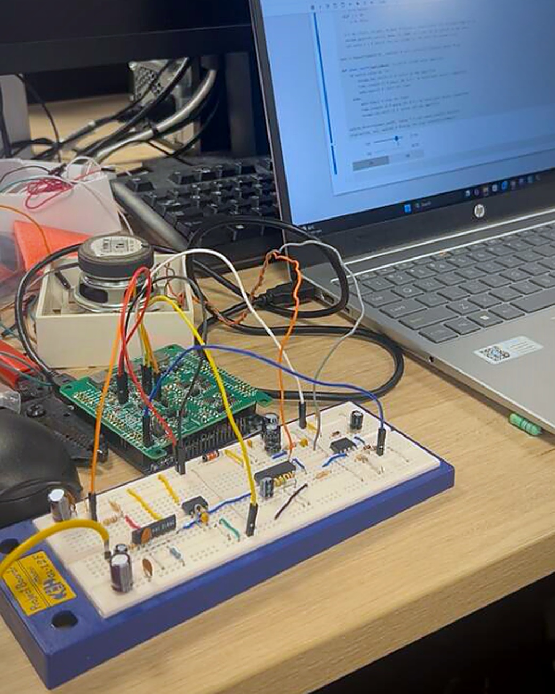

### Overview:
Over nine lab sessions, my lab partner and I built an audio amplifier that keeps its own volume steady. Music from a laptop goes through a **voltage-controlled amplifier (VCA)** and a **power amplifier (PA)** to a speaker. A **VU meter** turns the speaker signal into a DC "loudness" voltage. A Python loop running on the laptop reads that voltage through an **STM32 microcontroller** and adjusts the VCA's gain every 10 ms to hold the volume at a set level.

It's a full analogue + software feedback system. Each stage was built and measured on its own first (Labs 5–7), then everything was integrated on one breadboard (Lab 8), and finally the loop was closed in software (Lab 9).

### Problem Statement:
> *How might we keep an audio amplifier's output at a steady, user-set volume automatically, instead of relying on someone to listen and adjust the gain by hand, using an analogue signal chain and a simple software controller?*

### Approach: Take the person out of the loop
Lab 8 ended with a working but **manual** amplifier: you read the VU meter and adjusted the control voltage yourself. Lab 9 closed that loop in software.

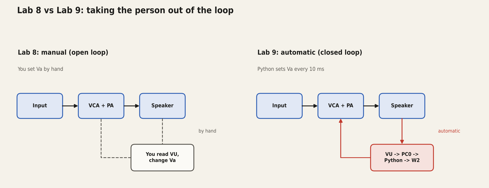

| The Problem (Manual, Lab 8) | The Solution (Automatic, Lab 9) |
| :--- | :--- |
| **Open loop:** nothing corrects the volume when the input gets louder or softer. | **Closed loop:** the VU meter reading is fed back and the gain is corrected continuously. |
| **Human in the loop:** someone has to watch the VU reading and retune Va. | **Python controller:** reads PC0 and writes a new Va on W2 every 10 ms. |
| **Judged by ear:** loudness is subjective. | **Measured:** loudness is a 0–3.3 V reading compared against a set point. |

### System Architecture
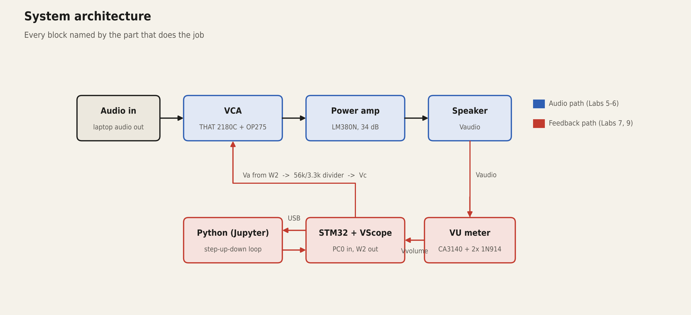

| Subsystem | Parts | Job in the loop |
| :--- | :--- | :--- |
| **VCA** (Lab 5) | THAT 2180C VCA, OP275 op-amp, 56k/3.3k divider | **Actuator:** gain set by Vc (−6 mV/dB spec) |
| **Power amp** (Lab 6) | LM380N (34 dB fixed gain) | Drives the speaker |
| **VU meter** (Lab 7) | CA3140 op-amp, 2× 1N914, RC smoothing | **Sensor:** turns audio into a DC level |
| **Controller** (Labs 1–4, 9) | STM32F4 + VScope board, Python in Jupyter | **Brain:** reads PC0, writes Va on W2 |
| **Supply** | ±13.5 V from the VScope board, 820 µH inductor | Keeps PA current surges off the VCA rail |

### The Circuit
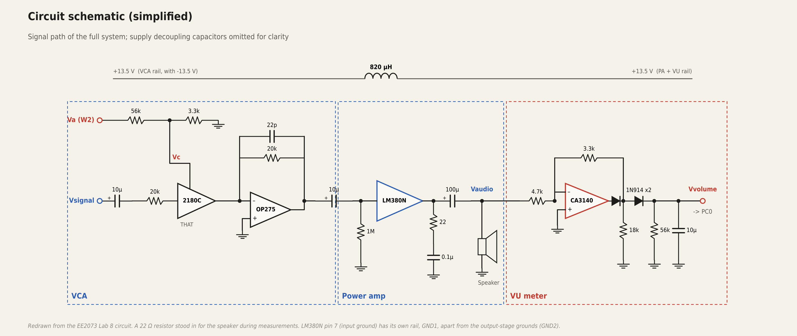

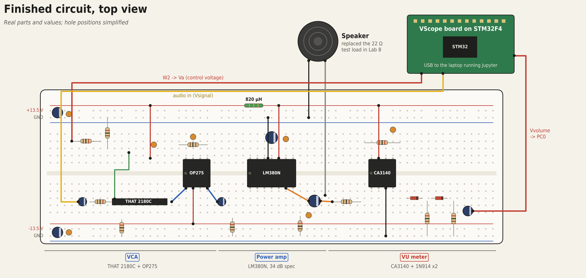

### Background & Topics Covered
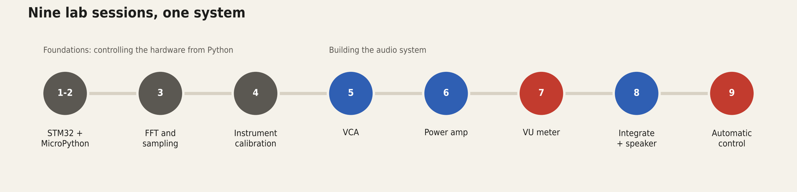

- **Labs 1–4, foundations:** controlling the STM32 over serial with MicroPython, SPI to a digital potentiometer for the DC supply, generating waveforms on the DAC, sampling on the ADC (Nyquist), FFT analysis of sine, triangle and sawtooth waves, and calibrating out DC offsets in the instruments
- **Analogue design:** VCA gain law, op-amp buffering, coupling and decoupling capacitors, power amplification, separate signal and power grounds
- **Signal measurement:** precision rectification, RC smoothing, RMS vs peak-to-peak
- **Control:** open vs closed loop, step-up-down (bang-bang) control, step size vs stability, timing in a non-real-time OS

### Control Method
The Lab 9 step-up-down controller ([`code/auto_volume_control.py`](code/auto_volume_control.py)):
```
z(n)     = V_PC0 / 3.3 V × 100            # measured volume, % of full scale
u(n+1)   = u(n) − Δ    if z(n) < r0       # too quiet → lower Va → more gain
u(n+1)   = u(n) + Δ    if z(n) > r0       # too loud  → raise Va → less gain
Va       = clip(u, −2.7 V, 9.0 V)         # keeps Vc inside −0.15 … 0.50 V
Vc       = 3.3k / (56k + 3.3k) × Va       # divider into the THAT 2180C
```
- **r0** = set point from the "Set" slider, **Δ** = 0.05 V, run every **10 ms**
- No tolerance band: if z ≠ r0, Va always moves

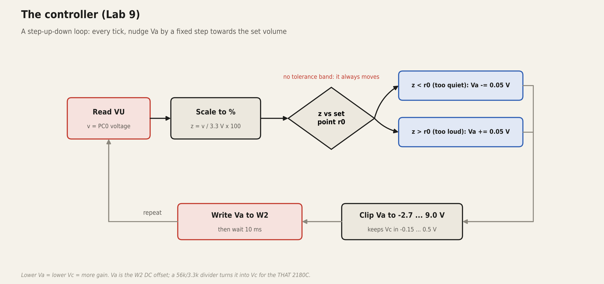

### Result & Validation:
**Demo passed.** Music played through the speaker clear and stable, with the volume regulated by the Python loop.

| Test | What we measured | Result |
| :--- | :--- | :--- |
| **VCA alone** (Lab 5) | Gain vs Vc, 10 points | Correct inverse trend; −10.6 mV/dB vs −6 spec |
| **Power amp** (Lab 6) | Gain, 100 Hz–10 kHz | Flat within ~2 dB; 27.5–31.7 dB vs 34 dB spec |
| **VU meter** (Lab 7) | Vout3 RMS vs input | Rises steadily; rectifier gain 0.67–0.69 vs 0.70 theory |
| **Full system** (Lab 8) | Gain vs Vc, 8 points | **−6.46 mV/dB, R² = 0.9996**; 54 dB of control range |
| **Closed loop** (Lab 9) | Live music, demo | Volume held at the set level; passed the demo |

The clearest result is the integrated system: gain tracks the control voltage almost perfectly, which is what makes automatic control possible.

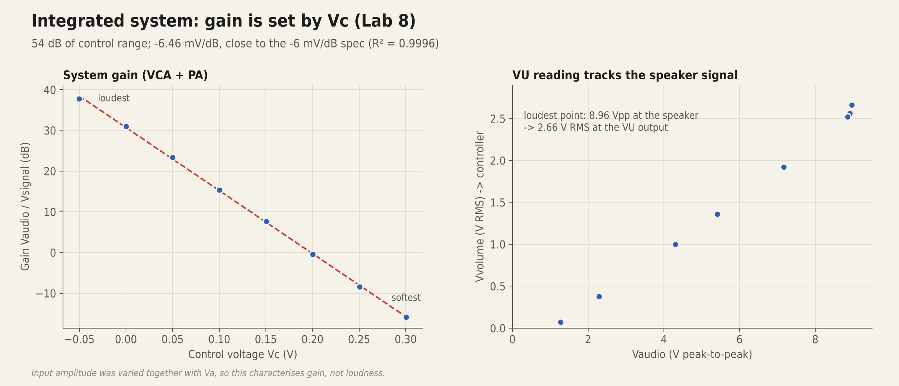

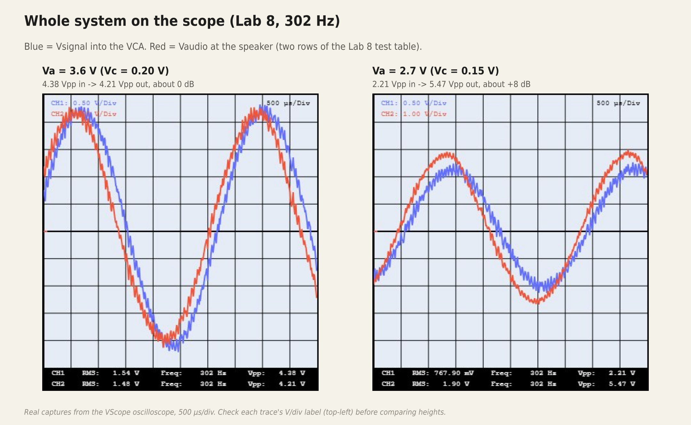

<details>
<summary><b>Subsystem results (Labs 5–7)</b></summary>

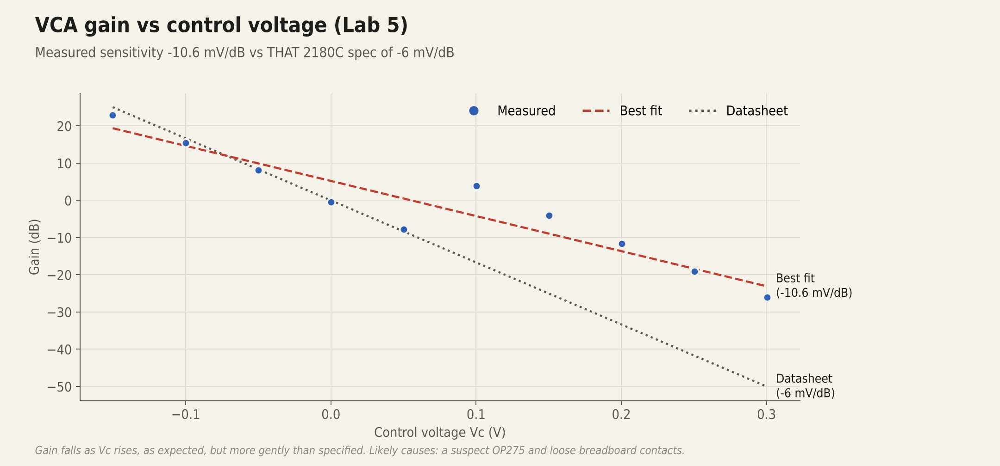

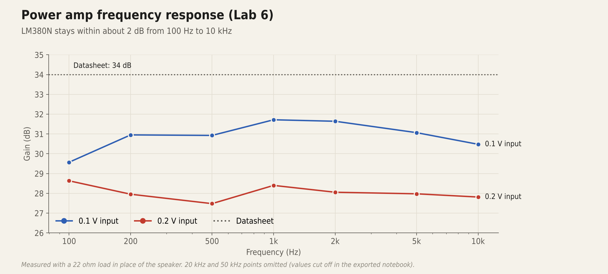

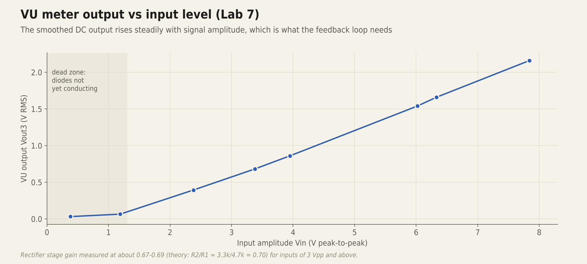

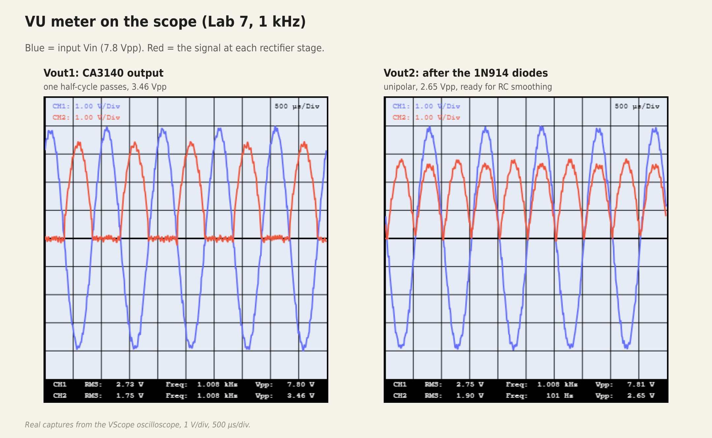

</details>

All raw numbers are in [`data/`](data) and [`docs/lab_notes.md`](docs/lab_notes.md). Every chart rebuilds with `python analysis/plot_results.py`.

### Challenges Faced
**1. VCA didn't match its datasheet (Lab 5).** Measured sensitivity was −10.6 mV/dB instead of −6 mV/dB, and a few points scattered. We re-seated wires, checked every ground and retuned the control code. The TA's view: likely a faulty OP275 or bad breadboard contacts. In the integrated build (Lab 8) the gain law came out at −6.46 mV/dB, close to spec.

**2. Screeching, distorted audio on first power-up (Lab 8–9).** The speaker produced a loud screech at start-up. We checked the wiring and reviewed the Python code. The cause was a ground connection on the wrong side of the breadboard. Moving it to the correct side gave clean audio that stayed clear as the volume went up.

**3. Clipping and noise at the extremes.** Large inputs with high gain clipped against the ±13.5 V rails. Tiny inputs with high gain amplified noise. The VU meter also has a dead zone below ~1.2 Vpp, where the diodes don't conduct.

**4. Fast vs stable control (Lab 9).** A bigger Va step reaches the set level faster but overshoots and oscillates. A smaller step is smooth but slow. With no tolerance band, the loop never settles completely.

**5. The loop isn't really every 10 ms.** `RepeatTimer` schedules the next call only after `control()` finishes, so each cycle also includes USB I/O, Python execution and OS scheduling delays.

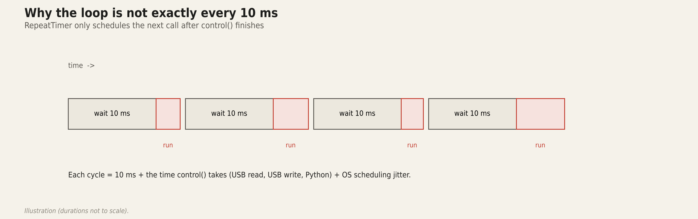

**6. Explaining the inductor at the demo.** Our first explanation of the 820 µH inductor didn't satisfy the examiner. We regrouped, gave the full answer and passed: it resists rapid current changes from the PA and blocks high-frequency noise, so instability can't travel round the loop into the VCA.

### Tools & Methods
- Hardware: breadboard build of THAT 2180C, OP275, LM380N and CA3140 stages driving a speaker
- Instruments: STM32F4 + VScope board (waveform generator, oscilloscope, ADC, programmable ±DC supply) driven from Python over USB serial
- Software: Python in Jupyter (`numpy`, `ipywidgets`, `pyserial`), MicroPython on the STM32
- Analysis: linear fits for gain laws, dB gain from peak-to-peak readings, FFT in the early labs; charts redrawn with Matplotlib ([`analysis/`](analysis))

### My Role
**Mohamed Asyhiddiq**, Group EJ04 / 07 (two-person lab team)
- Built, debugged and integrated the VCA, power amp and VU meter on one breadboard with my lab partner
- Took the measurements and wrote my own analysis notebook for every lab (1–9), plus the final report
- Implemented the Lab 9 step-up-down controller and compared different step sizes
- Helped find the grounding fault behind the screeching audio, and co-presented the live demo

### Future Recommendation
1. **Add a tolerance band.** Stop adjusting when z is within a few % of r0 so the gain stops hunting.
2. **Proportional (PI) control.** Scale each step by the size of the error: big corrections when far off, gentle ones when close.
3. **Run the loop on the STM32.** A hardware timer on the microcontroller removes the USB and OS timing jitter of a Python loop on the laptop.
4. **Fix the VU dead zone.** A precision rectifier or a true-RMS detector would measure quiet passages too.
5. **Measure the loop.** Log z and Va over time to quantify settling time and overshoot for each step size.

### Repository Structure
```text
audio-amplifier-feedback-control/
├── README.md
├── code/
│   ├── auto_volume_control.py   # Lab 9 closed-loop controller
│   ├── repeat_timer.py          # 10 ms timer (course-provided)
│   └── README.md                # wiring + how to run
├── data/                        # measured tables, Labs 5-8 (CSV)
├── docs/
│   └── lab_notes.md             # setup, all measurements, observations
├── analysis/
│   ├── plot_results.py          # charts from data/
│   ├── scope_panels.py          # labelled scope captures
│   ├── diagrams.py              # architecture, schematic, flowcharts
│   ├── breadboard_topview.py    # top-down circuit drawing
│   └── style.py
└── visuals/                     # every image in this README
    └── scope/                   # raw VScope captures
```

*Academic lab project. Circuit topology from the EE2073 lab manual; the VScope driver and firmware are course-provided and not included.*
